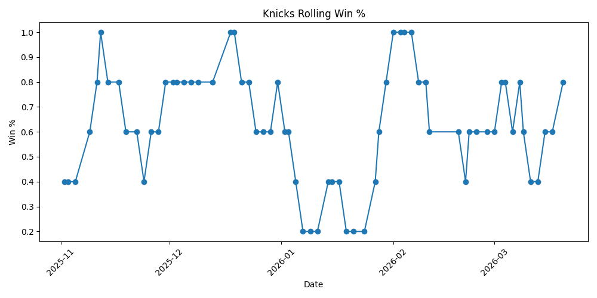

# 🏀 Knicks Win Probability Model

A machine learning project that predicts the probability of the New York Knicks winning each game based on rolling performance trends. Being born & raised in NYC and life-long NY Knicks fan, this one was special!

---

## 🚀 Features

- Rolling averages (last 3 & 5 games)
- Logistic regression classification model
- Win probability predictions
- Time-aware train/test split

---

## 📊 Example Output

Knicks win probability: 65.9%

---

## 🧠 Tech Stack

- Python
- Pandas
- Scikit-learn

---

## 📊 Knicks Rolling Win %



---
## ▶️ Run Locally

```bash
pip install -r requirements.txt
python model.py
