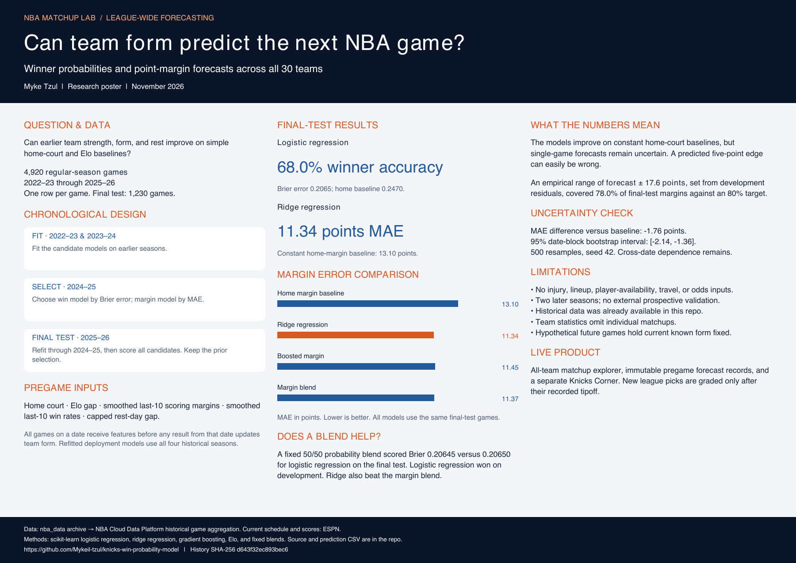

# NBA Matchup Lab · Knicks Corner

**[Open the live dashboard](https://knicks-win-probability-model-bymt.streamlit.app/)**

I started this project as a Knicks win predictor. I expanded the same repo so anyone can explore a matchup between any two NBA teams, see a win probability and expected point margin, and check how the models performed on later games.

The Knicks have their own tab, with the game previews, season tracker, model results, and film room that started the project.

## Try the app

- **All 30 teams** lets you choose an upcoming fixture or build a hypothetical matchup. Select the teams, date, and venue. Switch the viewing team to read its probability and point margin.
- **Knicks Corner** keeps the original Knicks dashboard, fan picks, model results, and videos together.
- **Model Research** compares the models and includes the research poster and final-test prediction CSV.

The expected margin is the selected team’s points minus its opponent’s points. A +5 forecast means an estimated five-point edge. The individual-game range is much wider, because real games vary.

## Why the Knicks still matter to me

I was born and raised in New York City, and my family has rooted for the Knicks for as long as I can remember. My dad has been a die-hard Knicks fan my whole life. Seeing how happy he was when we won the championship last season is something I’ll always remember. Building this app felt like a fun way to follow the next season together.

## Data and inputs

The historical dataset contains **4,920 regular-season games**, covering 2022–23 through 2025–26. Each game appears once, as home team versus away team. Archived player game logs were aggregated into team scores. Current schedules and finals come from ESPN.

| Input | What it captures |
| --- | --- |
| Home court | Home advantage or a neutral site |
| Team strength | The gap in Elo ratings |
| Recent point margin | Difference in smoothed last-10 scoring margins |
| Recent win rate | Difference in smoothed last-10 win rates |
| Rest | Days since each team played, capped at four days |

Five league-average pseudo-games stabilize early-season form. Elo carries across seasons with regression toward 1500. Recent form and rest reset. All games on a date receive features before any result from that date updates team state.

The model has no injury, lineup, availability, betting-odds, or travel inputs. A hypothetical future matchup uses the latest known earlier-date results. It does not simulate intervening games.

## Comparing the models

**Development** uses 2024–25, with models fitted on 2022–23 and 2023–24. I selected the win model by lowest Brier error and the margin model by lowest mean absolute error, or MAE.

**Final test** uses 2025–26 after refitting candidates on seasons through 2024–25. The selection rule was frozen before scoring these 1,230 games. This historical data already existed in the repository, so this is a reproducible chronological experiment. External blind validation is still pending.

### Winner probabilities on the final test

| Model | W/L accuracy | Brier error | Log loss |
| --- | ---: | ---: | ---: |
| Constant home-win baseline | 55.4% | 0.2470 | 0.6872 |
| Elo | 67.8% | 0.2097 | 0.6082 |
| Logistic regression · selected | 68.0% | 0.2065 | 0.6007 |
| Boosted trees | 67.8% | 0.2080 | 0.6035 |
| Equal-weight probability blend | 67.6% | 0.2065 | 0.6000 |

Brier error and log loss measure probability error. Lower is better. W/L accuracy uses a 50% cutoff.

The blend’s unrounded Brier score was 0.206453 versus 0.206497 for logistic regression. That small final-test advantage did not change the earlier selection.

### Point margins on the final test

| Model | MAE in points | RMSE in points |
| --- | ---: | ---: |
| Constant home-margin baseline | 13.10 | 16.41 |
| Ridge regression · selected | 11.34 | 14.55 |
| Boosted margin model | 11.45 | 14.69 |
| Equal-weight margin blend | 11.37 | 14.60 |

The margin model improved MAE by about **1.76 points** against the constant baseline. Its 11.34-point error also shows why an estimated edge should be read with uncertainty.

Boosted models use 100 trees, depth two, learning rate 0.04, minimum leaf size 30, and seed 42. Blends use fixed 50/50 weights. Blend weights were not tuned on the final test.

The deployed models are refitted on all four historical seasons after evaluation. Coefficients and tree structures are exported to JSON. The dashboard and hourly refresh use plain Python inference, without scikit-learn or pickle files at runtime.

## Uncertainty and limitations

The individual-game range uses the 80th percentile of absolute development residuals, about **17.6 points** either side of the forecast. It covered **78.0%** of final-test outcomes. Future coverage can differ.

A date-block bootstrap with 500 resamples and seed 42 gave a 95% interval of **−2.14 to −1.36 points** for the selected margin model’s MAE difference against the baseline. The Brier difference interval was **−0.0511 to −0.0295**. These are descriptive comparisons. Games across dates remain related.

Only two full later seasons were evaluated. Injuries, roster changes, and changing league conditions can affect future performance. Each game contributes to both team rows in the team-level table, while the league headline counts each game once.

## Updates and saved picks

The hourly GitHub Actions job fetches ESPN’s team catalog, all 30 schedules, and recent league scoreboards. It checks schedule coverage, retries failed requests, and atomically replaces the snapshot after a complete refresh.

The first saved projection within 24 hours before tipoff is preserved. A changed tipoff invalidates a saved pick for grading. The original Knicks ledger keeps its format, and league tracking has its own ledger. Earlier scores appear without retrospective forecast records.

Future fixtures are early projections based on the current snapshot. Unassigned NBA Cup games appear after ESPN assigns the teams. The dashboard displays refresh time and warns when the snapshot is more than three hours old.

## Research poster

[Download the research poster](research/nba-matchup-poster.pdf)

The poster is generated from the same model artifact shown in the dashboard. The [final-test predictions](data/league-test-predictions.csv) make the results inspectable. The [model artifact](data/league-model.json) includes the history fingerprint, configuration, scores, and uncertainty checks.

## Run and reproduce

~~~sh
python -m pip install -r requirements.txt
python -m streamlit run app.py
python -m unittest discover -s tests -v
~~~

~~~sh
python -m pip install -r requirements-training.txt
python -m scripts.train_league
python -m pip install reportlab==5.1.0
python -m scripts.build_poster
~~~

Run **python -m scripts.refresh** to update the current season. The original **python -m scripts.train** reproduces the legacy Knicks model. Both app.py and the original model.py entry point launch the expanded dashboard.

Tests check earlier-date inputs, all 30 teams, self-matchup rejection, neutral-site features, forecast lock windows, saved-pick preservation, changed tipoffs, development-only selection, and the custom Streamlit workflow. GitHub Actions also reproduces the final-test scores.

## Sources

Historical results were aggregated from the [NBA Cloud Data Platform snapshot](https://github.com/Mykeil-tzul/wonderworlds/tree/373000e259ef1c68681160fa04a329004e43606d), sourced from the [nba_data archive](https://github.com/llimllib/nba_data). Fixtures and scores come from [ESPN](https://www.espn.com/nba/scoreboard). The Knicks mark comes from the [NBA](https://www.nba.com/knicks/). League team logos are served locally from the image URLs supplied by ESPN’s team catalog.

Methods follow the official [scikit-learn ensemble documentation](https://scikit-learn.org/1.7/modules/ensemble.html) and [model evaluation documentation](https://scikit-learn.org/1.7/modules/model_evaluation.html).
